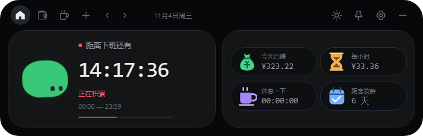

# 下班倒计时 · Payday v1.4.0

小巧的 Windows 桌面悬浮窗：下班倒计时、今日收入、休息记录。免登录，数据仅保存在本机。




截图使用合成示例数据。

## 打开程序

打开 `release-current/Payday-win32-x64/Payday.exe`。分享时使用上一级目录中的 `Payday-Windows-x64.zip`，完整解压后运行，保留同目录全部文件。

升级前从系统托盘退出旧版。工资、排班和休息记录存放于系统用户数据目录，清理旧程序不删除个人设置。

## 使用

- 按住顶部空白处自由拖动，自动记住位置。
- 鼠标移开约0.65秒后，切换到屏幕顶部正中的320×48信息条，显示倒计时和今日已赚。
- 悬停信息条展开；托盘或Ctrl+Alt+P恢复上次拖放的位置。
- 图钉固定展开；设置页及文件对话框期间保持展开。
- 支持深浅主题、隐藏收入、休息计时、发薪日和本地JSON备份。

## v1.4.0 修复

主面板和信息条各使用一个真正的小窗口。移除全屏透明画布、窗口裁剪区域以及移动缩放叠层。

开合使用约220毫秒的原生窗口透明度过渡；过渡结束真正隐藏旧窗口，防止残影或不可见窗口拦截输入。悬停不会抢走正在使用的其他窗口的焦点。数字14px、标签11px继续保留。

## 开发与打包

需要 Windows 10/11 x64、Node.js 22.12或更新版本。原生窗口测试还需Python 3。

```sh
npm ci
npm start
npm test
npm run test:native
npm run package
```

`release-current/`只保留最新版程序。`app/`是界面，`tests/`是测试，`docs/images/`是当前截图。`.test-output/`是运行测试时生成的临时目录。

见[验证说明](VALIDATION.md)。
